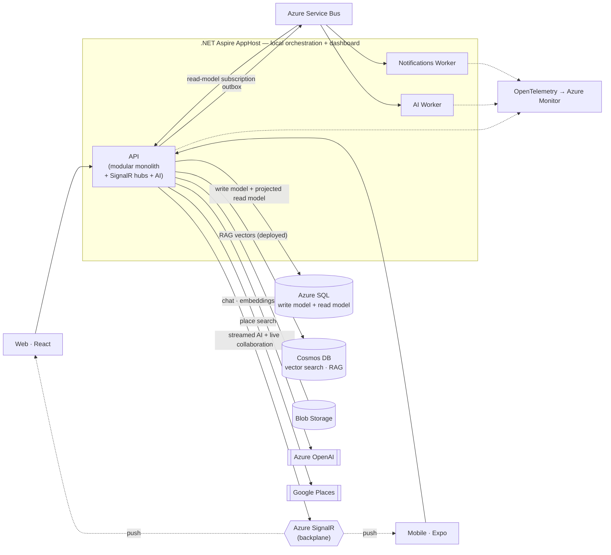

# Explivio — Architecture

> A modern, distributed **.NET 10** trip-planning platform with **AI** at its core.
> Built as a reference-quality showcase: event-driven, observable, tested, and cloud-native.

---

## 1. Intent & guiding principles

Explivio demonstrates the ability to design and build a **modern .NET distributed system with first-class AI support**. The architecture optimizes for:

- **Clear seams over sprawl** — a modular-monolith API with vertical slices, plus a couple of independently-deployed workers that demonstrate decoupled, independently-scaled event consumers. Not cargo-cult microservices — the split is where a real system would draw it, not everywhere.
- **Event-driven & reliable** — domain events over a message broker, with the transactional outbox pattern so nothing is lost or duplicated.
- **AI as a product capability, not a bolt-on** — RAG, agentic tool-calling, structured outputs, streaming, and AI observability.
- **Operable by default** — OpenTelemetry traces/metrics/logs, health checks, resilience pipelines, from day one.
- **Provable** — integration tests against real dependencies (Testcontainers), CI/CD via GitHub Actions.

**Principle:** every architectural choice should be defensible in an interview. Prefer the idiomatic 2026 .NET approach and be able to explain the trade-off.

---

## 2. System topology



> **Where the AI runs:** itinerary generation, the chat assistant and RAG run **synchronously inside the API** and stream to the client over SignalR — not in a worker. The **AI Worker** and **Notifications Worker** are domain-event *consumers* off the outbox (the AI Worker demonstrates the independent-consumer + inbox-dedupe pattern; the Notifications Worker fans out push / in-app alerts). The API is itself a read-model subscriber (the projector is hosted in-process).

**Deploy:** `azd` → Azure Container Apps (Bicep generated/augmented from the Aspire model).

### Deployable units
| Unit | Responsibility | Why separate |
|---|---|---|
| **API** | HTTP surface, command/query handling, writes, the SignalR hubs, **and all AI** (generation, assistant, RAG — synchronous + streamed), plus the in-process read-model projector | The core; stays a modular monolith |
| **AI Worker** | Consumes domain events off a dedicated Service Bus subscription with its own inbox-dedupe store | Reference implementation of an independently-deployable, independently-scaled consumer (the pattern, kept deliberately small) |
| **Notifications Worker** | Consumes domain events → fans out push + in-app notifications to the trip's other members | Decouples fan-out side-effects from the request path |
| **AppHost** (dev only) | Orchestrates all services + backing resources locally, wires config/discovery, hosts the dashboard | Aspire developer inner-loop |
| **ServiceDefaults** (library) | Shared OpenTelemetry, health checks, resilience, service discovery | Consistent cross-cutting wiring across every service |

---

## 3. Backend architecture (the API)

**Modular Monolith + Vertical Slice.** Each module owns its domain; each feature is a self-contained slice.

```
Modules/
  Trips/        Users/        Itinerary/        Budget/   (+ future: Places, Collaboration, AI, Social)
    Feature/
      XCommand.cs / XQuery.cs   ← MediatR request
      XHandler.cs               ← business logic
      XValidator.cs             ← FluentValidation
    XModule.cs                  ← Minimal API endpoint mapping
    Entity.cs                   ← domain type
```

**Request pipeline (MediatR behaviors):**
`Endpoint → ValidationBehavior → LoggingBehavior → Handler`

- **Validation** moves out of endpoints into a pipeline behavior → slices stay thin.
- **Idempotency lives at the boundaries, not in the mediator:** mutating HTTP endpoints honor an `Idempotency-Key` header; message consumers dedupe on message id. (The in-process mediator pipeline is the wrong layer for it.)
- **Errors:** expected failures flow as a `Result` type (not-found, forbidden, conflict); unexpected exceptions are caught by a global `IExceptionHandler` and rendered as **ProblemDetails (RFC 9457)**.
- **API surface:** Minimal APIs grouped per module (`MapXEndpoints()`), `.Produces<T>()` annotations, URL-segment **API versioning** (`/v1`), and per-user **rate limiting** (built-in sliding-window limiter partitioned by the `sub` claim). Trip-scoped routes run through a single `RequireTripRole` authorization filter (Owner/Editor/Viewer); feature-gated routes through a `RequireFeature` filter.
- **Contracts:** C# is the single source of truth → OpenAPI (`/openapi/v1.json`) → `openapi-typescript` generates `@explivio/shared` types. **Types are never hand-written.**

---

## 4. Data architecture

| Store | Role | Notes |
|---|---|---|
| **Azure SQL** (EF Core) | System of record for all relational data (trips, activities, expenses, users, members, reservations, checklists, documents metadata, follows, device registrations), the **CQRS read model** (`read` schema) and **notifications** | Migrations checked in; the workers keep their inbox tables in their own schemas in the same database |
| **Cosmos DB** | **Vector search for RAG only** (place embeddings) | Serverless, DiskANN vector index, partitioned by destination. Provisioned only when deployed; a local in-memory retriever stands in for `aspire run` and tests (see §6) |
| **Blob Storage** | Trip cover photos, trip documents, expense receipts, generated PDFs | Azurite emulator locally |

There is **no Redis**: the rate limiter and the AI semantic cache are in-process (a distributed cache would be the first thing to add when scaling past one API replica).

**CQRS read model (scoped to one feature):** writes go to SQL inside a transaction; a domain event + outbox row is written in the *same* transaction (via a `SaveChanges` interceptor). To demonstrate the pattern without doubling every write path, **exactly one** feature — the per-trip dashboard summary (activity count + total spend) — has an event-driven projector that maintains a denormalized **read model** in a separate SQL `read` schema (own migrations history, isolated from the write model). The projection and an inbox-dedupe row are committed together for exactly-once projection. The projector is hosted **in-process in the API** (the API is both publisher and subscriber). Everything else reads straight from the write model. The seam is designed so the pattern can be extended — or moved to Cosmos — later if warranted.

**RAG:** a seeded corpus of real places is embedded (Azure OpenAI `text-embedding-3-small`, or a deterministic offline stub) and stored as vectors in Cosmos DB vector search; the itinerary generator retrieves the top-k relevant places at request time and grounds the prompt. RAG is best-effort — a retrieval failure never blocks generation.

---

## 5. Messaging & eventing

- **Broker:** Azure Service Bus (Aspire runs an emulator/container locally; real Service Bus in Azure).
- **Transactional outbox:** events are persisted alongside state changes, then relayed to the broker — exactly-once *effect* via at-least-once delivery + idempotent consumers.
- **Idempotency:** consumers dedupe on message id (mutating HTTP endpoints use the `Idempotency-Key` header) — see §3.
- **Contract evolution:** events are additive-only. Each consumer keeps its **own minimal copy** of the event contract and matches by the message `Subject` (the event type name); System.Text.Json ignores fields a consumer doesn't know about, so a publisher can enrich an event without breaking older consumers (this is exercised — the workers deserialize the same event the richer projector uses). A genuinely breaking change would ship as a new event type consumed in parallel until cutover.
- **Trace propagation:** W3C trace context is carried in message metadata so a single distributed trace spans API → Service Bus → worker — the Aspire dashboard / Azure Monitor shows the end-to-end flow, not disconnected fragments.
- **Example flows:**
  - `TripCreated` → fanned out to three independent subscriptions: the read-model projector seeds the dashboard summary, the AI Worker records it (consumer-pattern demo), the Notifications Worker is available for welcome nudges.
  - `ActivityAdded` / `ExpenseAdded` → read-model projector updates the trip dashboard summary (activity count / total spend) in the SQL `read` schema.
  - A member edits a shared trip → the API broadcasts immediately to the trip's SignalR group via `IHubContext` (live collaboration), **and** a notification is raised through the outbox → Notifications Worker → the other members' devices. Note the deliberate split: "live" edit-nudges bypass the 5-second outbox so they feel instant; durable notifications go through it.
- **AI generation is *not* eventing.** Itinerary generation and the chat assistant are synchronous request/response that stream their output over SignalR from within the API — no `ItineraryGenerationRequested`/`ItineraryGenerated` round-trip. (Moving generation behind the queue would be the change if it ever needed to be fire-and-forget.)

---

## 6. AI architecture

All AI runs **inside the API**, behind a small set of interfaces so the provider and the on/off state are config-driven.

- **Abstraction:** `Microsoft.Extensions.AI` is the baseline for provider-neutral chat/embeddings and tool/function calling. **Semantic Kernel is not used** — it was kept as an opt-in option, but nothing in the agent workflow needed its planners/memory, so it was never pulled in (the two overlap).
- **Model host:** Azure OpenAI (chat + embeddings + vision), selected by config. With no `AI:*` config the API falls back to a **deterministic stub**, so the whole app builds, runs and tests with **no API key**.
- **Capabilities:**
  - **Structured-output itinerary generation** — the prompt returns a schema-validated JSON itinerary (no brittle text parsing), **streamed** to the UI token-by-token over SignalR.
  - **Agentic chat assistant** — grounded Q&A plus tool-calling edits (add/update/delete activities, add an expense, change status), role-gated so a Viewer gets read-only Q&A.
  - **RAG** — Cosmos vector search over the seeded place corpus grounds generation (§4).
  - **Multimodal** — receipt scanning → draft expenses; booking-email parsing → draft activities/reservations (vision + text).
  - **AI trip recap** — a grounded narrative looking back on a completed trip, streamed and saved.
- **Safety & ops (the "AI ops" layer):** every model call runs through a chain of delegating `IChatClient` middleware — **usage/cost telemetry** on an OpenTelemetry meter (surfaced on an in-app AI-usage page), an **in-process semantic cache** that short-circuits repeat prompts, and **Azure AI Content Safety** input moderation — all behind feature flags. A separate `Explivio.Evals` project is a lightweight **eval harness** that scores output against the *real* configured model (structured-output, extraction, and an LLM-as-judge groundedness check).

---

## 7. External integrations

| Integration | Use | Secret / access |
|---|---|---|
| **Google Places (New)** | Place search + details + coordinates in the itinerary | Browser key restricted by referrer + scoped to minimum APIs |
| **Azure OpenAI** | Chat, embeddings, vision (see §6) | Managed Identity in cloud (no key); user secrets locally; deterministic stub when unset |
| **Open-Meteo** | Per-day weather + destination time zone (F28) | Public GET, **no key**, cached |
| **Frankfurter** | Live FX rates for multi-currency budgets (F25/F28) | Public GET, **no key**, cached |
| **Calendar** | Itinerary export to iCalendar `.ics` + a share-token subscription feed for Google/Outlook/Apple (F27) | Generated server-side; feed behind a share token |
| **Email / booking parsing** | Upload a confirmation (`.eml`/text/screenshot) → the model extracts activities + reservations (F18) | Uses the Azure OpenAI integration above |

Maps render with **Leaflet + OpenStreetMap** (keyless) from the coordinates stored on activities.

- **No third-party secret in source or client bundles.** Browser-exposed keys are referrer-restricted and minimally scoped; everything server-side uses **Key Vault + Managed Identity**.
- External calls run through **resilience pipelines** (retry / circuit-breaker / timeout) and are **traced** like any other dependency.
- Integration failures **degrade gracefully** — a missing weather lookup never fails an itinerary load.

---

## 8. Cross-cutting concerns

| Concern | Approach |
|---|---|
| **Observability** | OpenTelemetry (traces + metrics + logs) → Azure Monitor; Aspire dashboard locally |
| **Resilience** | Standard resilience handlers (retry, circuit breaker, timeout) via ServiceDefaults |
| **Health** | `/health` (readiness) + `/alive` (liveness) on every service |
| **Config & secrets** | Aspire-wired config + service discovery; Azure Key Vault + Managed Identity in cloud |
| **Feature flags** | `Microsoft.FeatureManagement` over the `FeatureManagement` config section (appsettings / env), enforced by a `RequireFeature` endpoint filter |
| **Auth** | **Shipped — Microsoft Entra External ID** (CIAM). The API validates bearer tokens; web signs in via **MSAL**, mobile via **expo-auth-session** (PKCE). An external→internal identity seam (`CurrentUserResolutionMiddleware`) maps the provider `sub` to an internal user id, so everything downstream works in internal ids. It's **env-gated coexistence**: real auth turns on only when the client env vars are set; otherwise the fast dev identity (`X-Dev-User`) still drives local work and the integration tests. See ADR&nbsp;0007. |

---

## 9. Frontend & mobile

- **Web:** React + Vite (TypeScript), **feature-based** structure mirroring backend slices; features never import each other (shared code in `shared/`). Types from `@explivio/shared` (generated).
- **Mobile:** React Native + Expo (SDK 58), at feature parity, wired to `@explivio/shared`. Styling is StyleSheet + a shared theme (dark mode follows the device); navigation is Expo Router.
- **Real-time:** SignalR client for live-collaboration presence/updates + streamed AI output.

---

## 10. Deployment & infrastructure

- **Local:** `.NET Aspire` AppHost brings up the API + both workers + a SQL container + the Service Bus emulator, with the dashboard for traces/logs. Azure-only resources without a local emulator (App Insights, Azure SignalR, Cosmos) are **publish-mode-only** — locally the app uses the Aspire dashboard for telemetry, in-process SignalR, and the in-memory RAG retriever. Run with the `http` launch profile so the API stays plain-HTTP on :5298 for the Vite dev server. The schema **auto-migrates on startup** (write + read), so a fresh clone needs no manual `ef database update`.
- **Cloud:** **Azure Container Apps** via **`azd`**; Bicep generated from the Aspire application model (no hand-written Bicep — the old App Service templates were retired). Managed Identity + Key Vault. The React SPA is **served from the API** (an azd prepackage hook builds it into `wwwroot`), so web + API share one origin and one deployable.
- **Cost posture — deployable, usually torn down.** `azd up` provisions everything on demand; the environment is **not kept running 24/7**. The README carries demo GIFs + screenshots as the durable "proof it runs"; `azd down` tears it back down. (SQL sits on the cheapest always-on Basic tier — the free offer's auto-pause broke the 5-second outbox poller.)
- **CI/CD:** two GitHub Actions workflows — **`ci.yml`** runs on every push/PR to `main` (restore → build → unit + Testcontainers integration tests) and gates merges via branch protection; **`deploy.yml`** is **manual (`workflow_dispatch`) only** — it runs `azd up`, deliberately *not* on push, because the stack costs money while it's up.

---

## 11. Testing strategy

| Layer | Tooling |
|---|---|
| Unit | xUnit v3 — handlers, validators, domain logic, the read-model projection, the event dispatchers |
| Integration | `WebApplicationFactory` + **Testcontainers** — a throwaway **SQL Server** container (and **Azurite** for Blob); the API runs its real pipeline against them. The broker is gated off in tests (the outbox interceptor still writes rows) |
| Contract | Generated OpenAPI → `@explivio/shared` TS types keep client & server in lock-step |
| AI evals | `Explivio.Evals` — scores output against the **real configured model**; skips when no `AI:*` config is set, so CI stays deterministic |

---

## 12. Tech stack

| Layer | Choice |
|---|---|
| Runtime | .NET 10, C# |
| API | ASP.NET Core Minimal APIs, MediatR (+ pipeline behaviors), FluentValidation |
| Orchestration | .NET Aspire (AppHost + ServiceDefaults) |
| Messaging | Azure Service Bus (+ outbox) |
| Relational | Azure SQL + EF Core 10 (write model, read model, workers' inboxes, notifications) |
| Vector / RAG | Azure Cosmos DB (serverless, DiskANN vector search) |
| Files | Azure Blob Storage |
| AI | Azure OpenAI via `Microsoft.Extensions.AI` (+ `IChatClient` middleware for cost/cache/safety) |
| Real-time | Azure SignalR (backplane in cloud; in-process locally) |
| Feature flags | `Microsoft.FeatureManagement` (config-driven) |
| Observability | OpenTelemetry → Azure Monitor / Aspire dashboard |
| Web | React + Vite (TypeScript) + Tailwind v4 / shadcn-ui |
| Mobile | React Native + Expo (SDK 58) |
| Compute | Azure Container Apps |
| IaC / Deploy | Bicep + `azd` (generated from the Aspire model) |
| CI/CD | GitHub Actions |
| Auth | Microsoft Entra External ID (MSAL web, expo-auth-session mobile) |
| i18n | i18next (en / es / de), locale-aware dates + currency |

---

_See [`docs/FEATURES.md`](docs/FEATURES.md) for the prioritized feature map and phased delivery roadmap, and [`docs/adr/`](docs/adr/) for the decision records behind the choices above._
