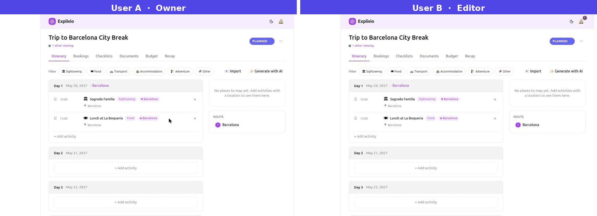
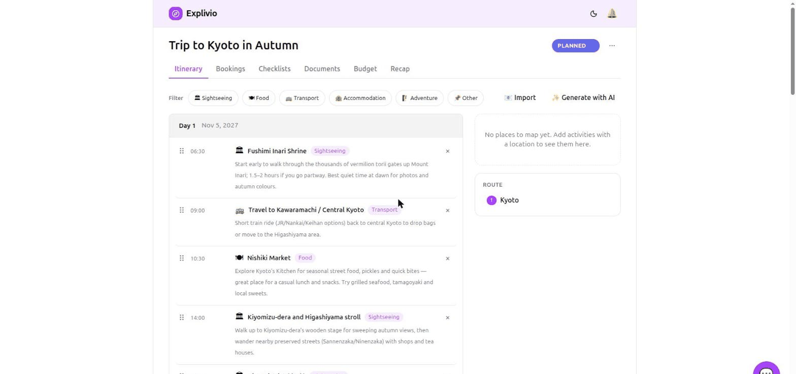
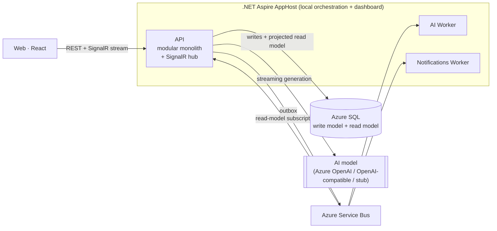

# Explivio

[](https://github.com/danijel-scukanec/explivio/actions/workflows/ci.yml)


> A modern, distributed **.NET 10** trip-planning platform with **AI** at its core — event-driven, observable, tested, and cloud-native.

Explivio is a reference-quality showcase of building a **modern .NET distributed system with first-class AI support**: a modular-monolith API, independently-deployed workers, a transactional outbox over a message broker, a CQRS read model, and AI itinerary generation streamed live to the UI. It favours **clear seams over sprawl** — every architectural choice is meant to be defensible, not cargo-culted.

---

## ✨ Demo — AI itinerary generation, streamed live

Describe the trip in plain language; the model returns a **structured** itinerary that is **streamed over SignalR** and revealed card-by-card, then added to the plan with one click.


*(Shown running against the built-in deterministic stub — no API key required. Point it at a real model to see tokens arrive over several seconds; see [Using a real AI model](#using-a-real-ai-model).)*

---

## ✨ Demo — real-time collaboration

Trips are shareable with role-based membership. When another member edits a shared trip, the change lands **live** — presence shows who's viewing, and the itinerary updates with no refresh. The push is an immediate in-process `IHubContext` broadcast, deliberately **not** routed through the 5-second outbox.



---

## ✨ Demo — trip status lifecycle

Every trip carries an explicit lifecycle status — **Draft, Planned, Active, Completed, or Cancelled** — set by the user independently of its dates. Changing it updates the colour-coded badge everywhere, and the trips list can be filtered by status.



---

## Highlights

- **Event-driven core with a transactional outbox** — domain events are persisted in the same transaction as the business change, then relayed to **Azure Service Bus**; consumers dedupe on message id for exactly-once *effect* over at-least-once delivery.
- **Independently-deployed workers** — an **AI Worker** and a **Notifications Worker** consume domain events off their own subscriptions, each with its own inbox-dedupe store.
- **CQRS read model** — a denormalized per-trip dashboard summary in its own SQL `read` schema, kept current by an event-driven projector (projection + inbox committed in one transaction).
- **AI as a product capability** — itinerary generation via `Microsoft.Extensions.AI` with **structured outputs** (typed JSON, no brittle text parsing) and **streaming to the UI over SignalR**. Provider-neutral: Azure OpenAI, OpenAI, Groq, or a local stub, chosen by config.
- **Real-time collaboration** — shareable trips with role-based membership (Owner/Editor/Viewer) enforced at a single authorization seam; live presence and edit-nudges over **SignalR**, pushed immediately via `IHubContext` rather than through the outbox, so "live" doesn't inherit the poll latency.
- **Operable by default** — OpenTelemetry traces/metrics/logs, health/liveness endpoints, and resilience pipelines wired through a shared `ServiceDefaults`, orchestrated locally by **.NET Aspire**.
- **Consistent HTTP contract** — `Result`-based error flow and a global exception handler, all rendered as **ProblemDetails (RFC 9457)**; validation, logging, API versioning, and per-user rate limiting as cross-cutting concerns.
- **Provable** — unit tests plus **Testcontainers** integration tests against a real SQL Server, run in **GitHub Actions** CI.
- **C# is the single source of truth for types** — the OpenAPI spec generates the `@explivio/shared` TypeScript types; frontend types are never hand-written.

---

## Architecture at a glance



The API both **publishes** domain events (via the outbox) and **subscribes** to them (the read-model projector runs inside it). For the full target topology, data architecture, and the reasoning behind each choice, see **[ARCHITECTURE.md](ARCHITECTURE.md)** and the decision records in **[docs/adr/](docs/adr/)**.

---

## Project status

This is an evolving portfolio project. The **committed target** — the foundation plus AI generation and streaming — is **complete**; the rest is a genuine, prioritized roadmap. See **[docs/FEATURES.md](docs/FEATURES.md)** for the full map.

**Built and verified**

| Area | What |
|---|---|
| Orchestration | .NET Aspire AppHost + ServiceDefaults, OpenTelemetry, health/resilience |
| API foundation | Vertical-slice modules (Trips, Users, Itinerary, Budget), MediatR pipeline, ProblemDetails + `Result` flow, API versioning, rate limiting |
| Eventing | Transactional outbox over Azure Service Bus |
| Workers | AI Worker + Notifications Worker (event consumption + inbox dedupe) |
| CQRS | Trip-dashboard read model, event-driven projector |
| AI | Itinerary generation (structured output) + **live streaming over SignalR**, with accept-to-itinerary flow in the web UI |
| AI assistant | **Conversational trip assistant** (F16) — grounded Q&A + **agentic edits** (add/update/delete activities, expenses, status) via tool-calling, streamed over SignalR; role-gated (Viewer = Q&A only) |
| Receipts | **Receipt scanning** (F17) — a photographed receipt read by a **vision model** into a draft expense (merchant, total, currency, category, date) for review; the image is stored in **Blob Storage** and streamed back through the API behind trip authorization |
| Trip recap | **AI trip recap** (F29) — a warm narrative looking back on a trip, **grounded** in its route, itinerary and budget and **streamed over SignalR**, saved as a keepsake, shown with a photo gallery (cover + trip images) |
| Booking import | **Booking-email parsing** (F18) — upload a confirmation (email .eml/text or a screenshot) and a **text/vision model** extracts the booking(s); it decides per item whether each is a draft **activity** or **reservation**, which you review and add in one go |
| RAG | Itinerary grounding by **vector search** — embeddings + place retrieval over **Azure Cosmos DB** when deployed, in-memory over a seeded corpus locally |
| Collaboration | Shareable trips with role-based membership (Owner/Editor/Viewer) + **real-time presence and live updates over SignalR** |
| Storage | Trip **cover photos** in **Azure Blob Storage** (Azurite emulator locally), streamed through the API behind trip authorization |
| Web | Trips (with **status lifecycle** badge + filter + **cover photos**), Itinerary (day-by-day + AI generate + **map**), Budget, Google Places search; map via **Leaflet + OpenStreetMap** (keyless) |
| Export | Itinerary to **iCalendar (.ics)** + **PDF** (QuestPDF), plus a share-token **calendar subscription feed** for Google/Outlook/Apple sync |
| Notifications | **In-app** notifications of trip changes to other members, delivered through the Notifications Worker (outbox → Service Bus → read model); 🔔 bell + unread badge on web + mobile, plus OS-level **push** — **mobile** (Expo + FCM) and **browser** (Web Push: service worker + VAPID) — fanned out from the worker, verified on-device (Android push, browser Web Push) |
| Auth | **Microsoft Entra External ID** sign-in — bearer-token validation on the API; web (MSAL) + mobile (expo-auth-session), with a **dev-identity fallback** (env-gated, so local work needs no tenant) |
| AI ops | **Token/cost telemetry**, a **semantic cache**, and **Azure AI Content Safety** moderation wrapped around every AI call as `IChatClient` middleware (metrics on the Aspire dashboard + an **AI usage** page), plus an **eval harness** (`Explivio.Evals`) that scores real-model output |
| Quality | Testcontainers integration tests + GitHub Actions CI |

**Roadmap (planned, not yet built)**

iOS push is **deliberately out of scope** — it needs a paid Apple Developer account (APNs / Safari-PWA web push), not justified for a deploy-on-demand showcase. Push ships on Android + web; Apple devices degrade gracefully (no crash, no OS push). See [ADR 0006](docs/adr/0006-ios-push-out-of-scope.md).

---

## Getting started

**Prerequisites:** [.NET 10 SDK](https://dotnet.microsoft.com/), [Docker](https://www.docker.com/) (for SQL + the Service Bus emulator and integration tests), [Node.js](https://nodejs.org/) 20+.

### Option A — Full distributed system via Aspire

Runs the API, both workers, SQL, and the Service Bus emulator together, with the Aspire dashboard for traces and logs.

```bash
cd backend
dotnet run --project Explivio.AppHost
```

The dashboard prints its URL on startup; the API listens on `http://localhost:5298`.

### Option B — API + web only (simplest inner loop)

Runs the API against a local SQL container (no broker; events are written to the outbox but not relayed). AI uses the built-in stub, so **no API key is needed**.

```bash
# 1. SQL Server
docker run -e ACCEPT_EULA=Y -e SA_PASSWORD='TestPSW80!' -p 1433:1433 \
  -d --name explivio-sql mcr.microsoft.com/mssql/server:2022-latest

# 2. Apply the relational migrations (the read model auto-migrates on startup)
dotnet ef database update --project backend/Explivio.API --context AppDbContext

# 3. API  (http://localhost:5298 — Development uses a fake dev identity)
dotnet run --project backend/Explivio.API

# 4. Web  (http://localhost:5173)
cd client && npm install && npm run dev --workspace frontend
```

Then open <http://localhost:5173>, create a trip, open its itinerary, and try **✨ Generate with AI**.

### Using a real AI model

By default the app uses a deterministic **stub** — great for building and CI, zero cost. To use a real model, set config keys (e.g. via `dotnet user-secrets` in `backend/Explivio.API`) and restart — **no code change**. Any **OpenAI-compatible** endpoint works (Azure OpenAI, OpenAI, Groq, local Ollama…):

| Key | Example (Azure OpenAI) |
|---|---|
| `AI:Endpoint` | `https://<resource>.openai.azure.com/openai/v1` |
| `AI:ApiKey`   | the resource key |
| `AI:Model`    | the deployment name (e.g. `gpt-5-mini`) |

**Embeddings** (for RAG) are a separate capability — not every chat provider offers them. Set `AI:EmbeddingEndpoint` (+ `AI:EmbeddingModel`; key falls back to `AI:ApiKey`) to use a real embedder; otherwise a deterministic in-memory embedder is used, so chat-only providers (e.g. Groq) still work.

### Tests

```bash
cd backend
dotnet test --solution Explivio.slnx
```

Unit tests run anywhere; the integration tests spin up a real SQL Server via Testcontainers (Docker required).

**AI evals** (`Explivio.Evals`) score real-model output, so they run against the configured model and skip when no `AI:*` config is set — the solution test above already includes them (skipped in CI, which has no model configured). To run just the evals against your configured model:

```bash
dotnet run --project backend/Explivio.Evals
```

---

## Deploying to Azure

The app deploys to **Azure Container Apps** with the **Azure Developer CLI (`azd`)**, driven by the Aspire model — a Container App for the API and each worker, plus Azure SQL, Cosmos DB, Service Bus, Storage, Application Insights, and the managed-identity role assignments. The Bicep was **generated** from the Aspire manifest (`azd infra gen`) and is **committed under `infra/`** as the source of truth, so it can be hand-tuned where needed (e.g. the Azure SQL managed-identity bootstrap script and the Cosmos vector container). See [ADR 0005](docs/adr/0005-bicep-over-terraform.md) for why Bicep + azd over Terraform.

**Prerequisites:** the [Azure Developer CLI](https://aka.ms/install-azd), the [Azure CLI](https://learn.microsoft.com/cli/azure/install-azure-cli), and an Azure subscription.

```bash
azd auth login && az login     # az is used by the post-deploy hook

# provision infrastructure + build and deploy every service, then tear down
azd up
azd down --purge
```

Or deploy from GitHub without a local toolchain: **Actions → "Deploy to Azure (manual)" → Run workflow** (a `workflow_dispatch` pipeline that runs `azd up` via OIDC — deliberately manual, never on push). One-time setup is in [`.github/workflows/README-deploy.md`](.github/workflows/README-deploy.md).

- **Deploy-on-demand** — brought up with `azd up` and removed with `azd down --purge`, not kept always-on; at rest it costs ~€0 (only the separate Azure OpenAI resource bills per-token).
- **One URL, no CORS** — the React SPA is built into the API's `wwwroot` (an azd `prepackage` hook) and served by the API, so the whole app is a single Container App + URL.
- **Passwordless everywhere** — services reach SQL, Cosmos, Service Bus, Storage **and Azure OpenAI** with a managed identity; there are **no secrets in the cloud** (`azd` + a post-deploy hook provision the role assignments and non-secret config).
- **Schema on startup** — the relational schema and read model migrate automatically when a service starts; no manual migration step.
- **Observability in the cloud** — the same OpenTelemetry that feeds the Aspire dashboard locally flows to **Application Insights**.
- **Sign-in after deploy** — add the deployed URL as a redirect URI on the SPA app registration in the Entra External ID tenant (Authentication → Single-page application).

---

## Repository structure

```
explivio/
  backend/           .NET 10 solution (Explivio.slnx)
    Explivio.API/            modular-monolith API (modules, read model, outbox, SignalR hub)
    Explivio.AIWorker/       AI job consumer
    Explivio.NotificationsWorker/  domain-event consumer
    Explivio.AppHost/        .NET Aspire orchestration (local dev)
    Explivio.ServiceDefaults/  shared OTel + health + resilience
    Explivio.*.Tests/        unit + Testcontainers integration tests
  client/            npm workspace
    frontend/          React + Vite (TypeScript)
    mobile/            React Native + Expo (SDK 58) — full feature parity with web
    shared/            types generated from OpenAPI + shared utils
  azure.yaml         azd config (infrastructure is generated from the Aspire model)
  docs/              ARCHITECTURE.md · FEATURES.md · adr/
```

---

## Documentation

- **[ARCHITECTURE.md](ARCHITECTURE.md)** — system topology, data & messaging architecture, AI design, cross-cutting concerns.
- **[docs/FEATURES.md](docs/FEATURES.md)** — prioritized feature map and phased delivery roadmap.
- **[docs/adr/](docs/adr/)** — architecture decision records (modular monolith, outbox, Aspire, deferred auth, Bicep over Terraform).
