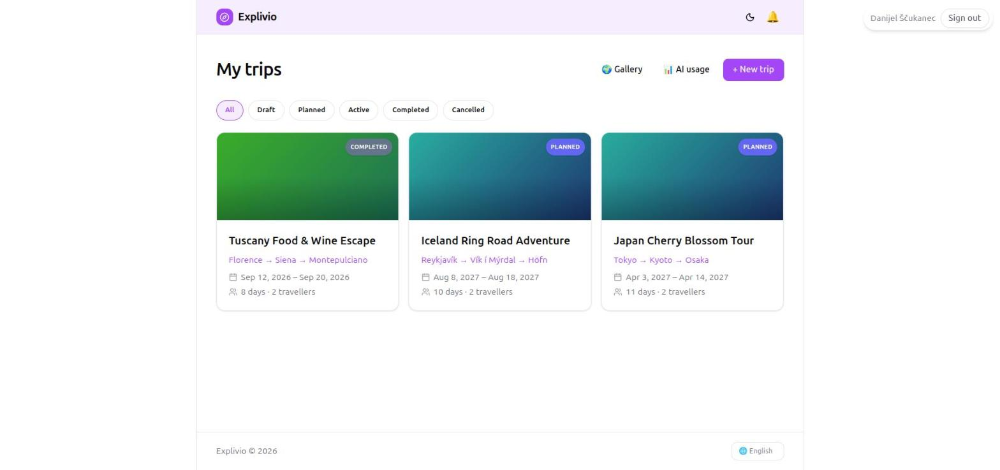
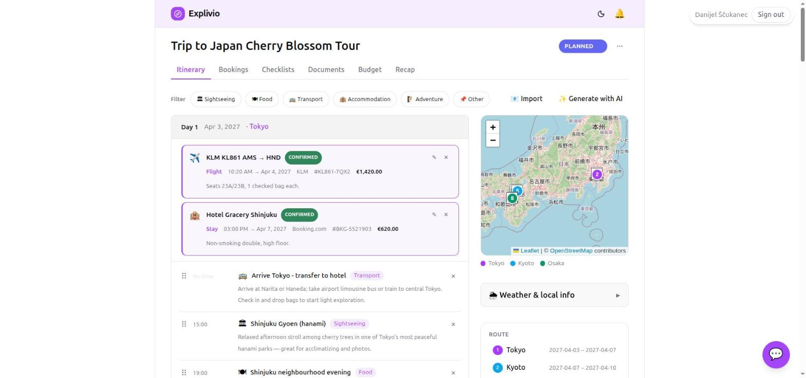
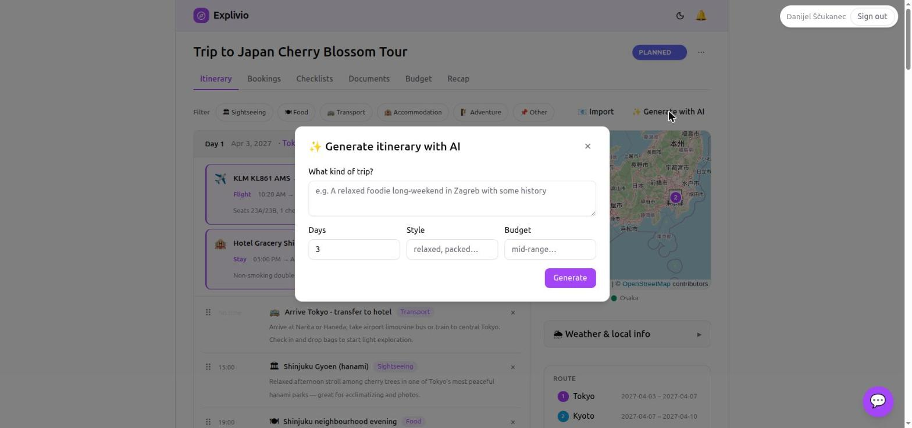
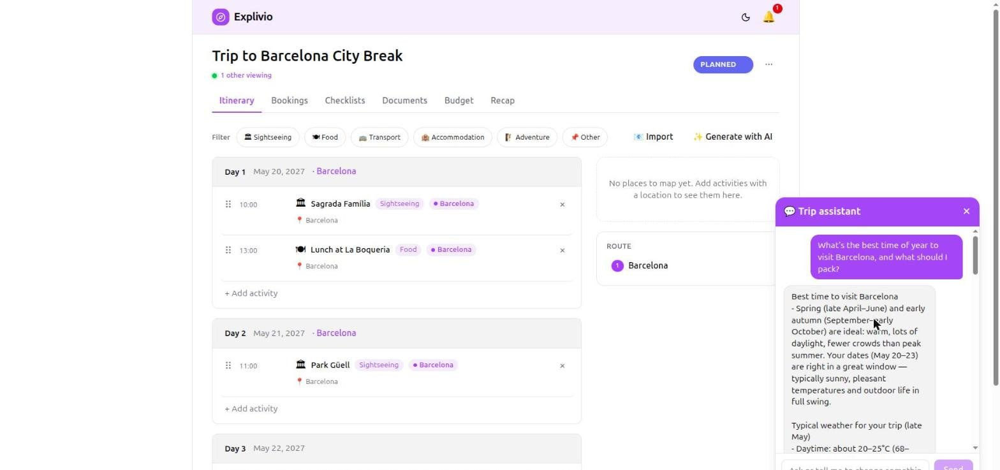
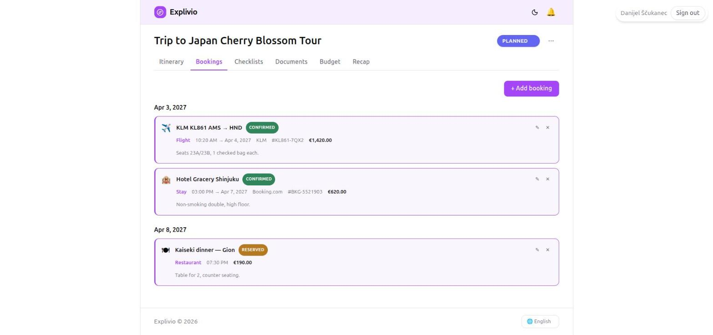
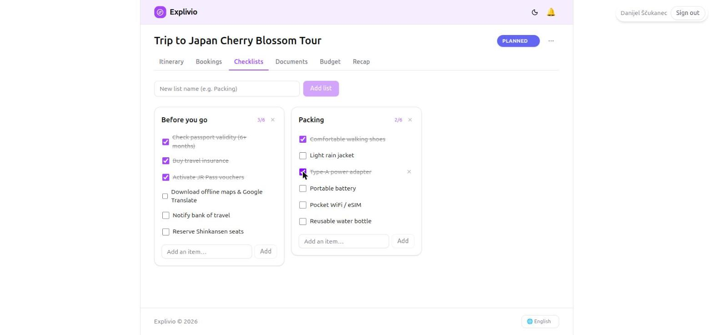
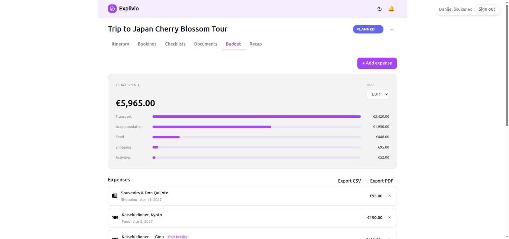
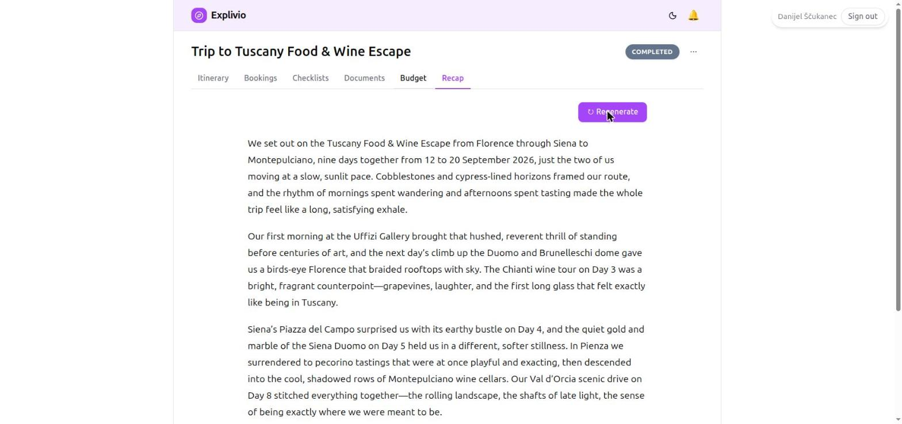
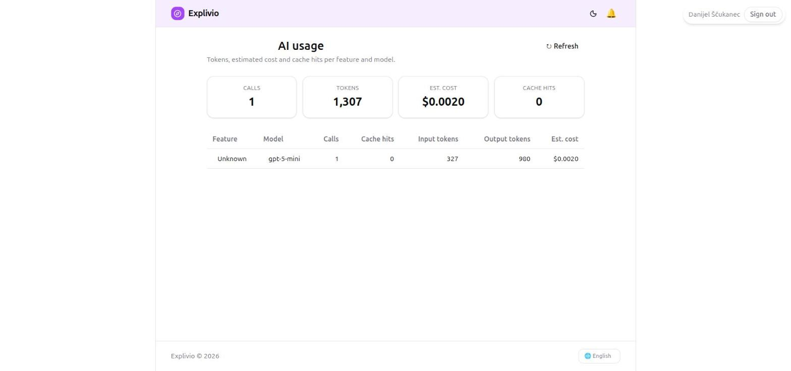
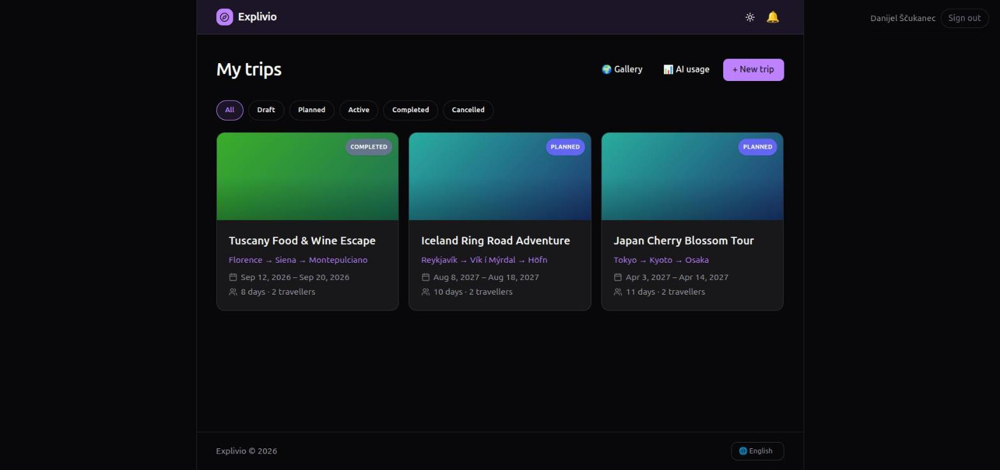

# Explivio — User Guide

Explivio is a collaborative, AI-assisted trip planner. Plan multi-stop trips day by day,
track bookings, budgets and packing lists, let AI draft your itinerary or answer travel
questions, and share finished trips with others. This guide walks through the app the way
you'll actually use it.

> Explivio runs on the **web** and as a **mobile app** (Android). The two are at feature
> parity; screenshots below are from the web app, and the mobile layout mirrors them with a
> bottom tab bar. Where something differs, it's called out.

---

## 1. Getting started

### Signing in
Open Explivio and sign in with your account. Access is handled through Microsoft Entra
sign-in — enter your email and password on the sign-in screen and you'll land on **My trips**.

Your session stays signed in across visits; if it expires, Explivio takes you back to the
sign-in screen. Sign out any time from the top-right of the header.

### Finding your way around
- The **header** (top) has the Explivio logo (home), a **theme toggle** (light/dark), and a
  **notifications bell**.
- **My trips** is your home base. From here you reach the **Gallery**, your **AI usage**, and
  the **+ New trip** button.

---

## 2. Your trips

**My trips** shows every trip you own or have been invited to, each as a card with its
cover, route (e.g. *Tokyo → Kyoto → Osaka*), dates and traveller count.

- **Status filters** across the top — **All, Draft, Planned, Active, Completed, Cancelled** —
  narrow the list. A trip's status also shows as a badge on its card.
- Each trip gets an automatic **gradient cover**; you can replace it with your own photo
  (see *Trip menu* below).

### Creating a trip
Click **+ New trip** and fill in:
- **Trip name**
- **Start / End dates**
- **Travellers** (how many people)
- **Budget currency** (EUR, USD, GBP, JPY, …) — everything in the budget is reported in this
- **Destinations** — one or more **stops**. Type a city in *Search for a city to autofill* and
  pick a suggestion so the stop gets map coordinates, then set each stop's **Arrive / Depart**
  dates. Use **+ Add stop** for multi-destination trips and the arrows to reorder.

Click **Create trip** and you'll open straight into its itinerary.

### The trip menu
Inside a trip, the **⋯** menu (top-right, next to the status badge) lets you:
- **Edit route** — change stops, dates and order
- **Add cover** — upload a cover photo
- **Members** — invite people and manage roles (see [Sharing & collaboration](#9-sharing--collaboration))
- **Share** — create a public or link-based share
- **Export** — download the itinerary (PDF / calendar)
- **Delete trip** — permanently delete the trip and everything in it (itinerary, bookings,
  checklists, documents and budget). Owner only, and you're asked to confirm first — this can't
  be undone.

Change a trip's **status** with the badge dropdown (Draft → Planned → Active → Completed → Cancelled).

---

## 3. The itinerary

The **Itinerary** tab is the heart of a trip: a day-by-day plan from your start to end date.

- Each **day** lists its **activities** with a time, a title, a **category** (Sightseeing,
  Food, Transport, Accommodation, Adventure, Other) and notes.
- **+ Add activity** on any day adds one. Give it a name, optional time, a category, and a
  **location** (via the same place search) so it appears on the map.
- **Drag** the handle on the left of an activity to reorder it within or across days.
- The **category filter** chips at the top show only activities of the types you pick.
- Your **bookings** (flights, hotels, dinners) appear inline on the matching day, marked
  **CONFIRMED / RESERVED**, so the plan and the reservations read as one timeline.

On the right:
- **Map** — every activity and stop with coordinates shows as a numbered pin, colour-coded by
  stop. (Pins appear once activities have a location.)
- **Weather & local info** — per-day weather and local tips for the destination.
- **Route** — your stops with their date ranges.

### Generate an itinerary with AI

Short on time? Click **✨ Generate with AI**, describe the kind of trip you want
(*"Cherry blossom season — temples, gardens, street food across Tokyo, Kyoto and Osaka"*),
set the number of **days**, a **style** (relaxed, packed…) and a **budget** level, then
**Generate**. Explivio drafts a full itinerary, streaming the days in as it writes them, and
you **Add all to itinerary** to apply them. Edit or remove anything afterwards.

### Import from a booking email
Use **📧 Import** to paste a booking confirmation email — Explivio reads it and turns it into
the right activities and reservations automatically.

### The AI trip assistant

The **chat bubble** (bottom-right of a trip) opens the **Trip assistant**. It knows your
trip's details and can:
- answer **travel questions** (what to eat, how to get around, what to pack, things to do), and
- **make changes for you** — "add a tea ceremony in Kyoto on day 6 at 3pm", "move dinner to
  7pm", "add a €40 taxi expense". It carries out the edit and the itinerary updates live.

Just type what you want in plain language.

---

## 4. Bookings

The **Bookings** tab holds your reservations — flights, accommodation, car rental,
restaurants, tours and more — grouped by date.

**+ Add booking** records a reservation with its **type**, **title**, **provider**,
**confirmation number**, **dates/times**, **status** (Reserved / Confirmed / Cancelled),
**cost** and notes. A booking with a cost automatically shows up in your **Budget** (marked
*from booking*), so you don't enter it twice, and it appears inline on the itinerary's matching day.

---

## 5. Checklists

The **Checklists** tab is for packing lists and to-dos. Create as many lists as you like
(e.g. *Before you go*, *Packing*), add items, and tick them off — each list shows its
progress (e.g. **3/6**) and checked items are struck through.

---

## 6. Documents

The **Documents** tab stores files for the trip — tickets, passport scans, confirmations,
insurance. Upload a file and it's kept with the trip so everyone with access can find it.

---

## 7. Budget

The **Budget** tab tracks what the trip costs.

- **Total spend** and a **category breakdown** (Transport, Accommodation, Food, Activities,
  Shopping, Other) at the top, all in the trip's **base currency**.
- **+ Add expense** records a cost with a description, amount, currency, category and date.
  Expenses in other currencies are converted using live exchange rates.
- **Scan a receipt** — add an expense by photographing a receipt; AI reads the amount and
  details for you.
- **Split expenses** — when a trip has more than one member, you can split a cost among
  people and Explivio tracks **settle-up balances** (who owes whom).
- **Export CSV / Export PDF** to take the budget with you.

---

## 8. Trip recap

Once a trip is **Completed**, open the **Recap** tab and click **✨ Generate recap**. Explivio
writes a warm, narrative look-back over your trip, drawing on the places you actually visited.
**Regenerate** any time for a fresh take.

---

## 9. Sharing & collaboration

### Members (plan together)
Open **Members** from the trip **⋯** menu. The **Owner** can **invite people by email**, set
each person's role, and remove them. There are three roles, each able to do everything the one
below it can:

| What they can do | Viewer | Editor | Owner |
|---|:---:|:---:|:---:|
| View the trip and everything in it | ✓ | ✓ | ✓ |
| Edit the itinerary, bookings, checklists, documents and budget | | ✓ | ✓ |
| Change the route, dates, status and budget currency | | ✓ | ✓ |
| Change the cover photo, create share links, generate the AI recap | | ✓ | ✓ |
| Invite people, change roles and remove members | | | ✓ |
| Publish the trip to the public gallery | | | ✓ |
| Delete the trip | | | ✓ |

In short: a **Viewer** can only look, an **Editor** can change the trip's content, and an
**Owner** also controls who has access, whether it's public, and whether it exists.

Invite someone who doesn't have an account yet and the invite is claimed automatically the
first time they sign in. Everyone editing a shared trip sees each other's changes **in real
time**, and changes (new activities, expenses, status changes) notify the other members.

### The public gallery
The **Gallery** (from My trips) is where public trips live — *discover, like, or clone one as
your own*. **Publish** a trip from its **Share** menu to add it to the gallery.

- **Like** trips you enjoy.
- **Clone** any public trip to get your own editable copy to adapt.
- **Follow** a traveller to see their new public trips in your **Following** feed, and visit
  anyone's **profile** (`/users/…`) to see their public trips and follower counts.
- When someone you follow publishes a trip, you get a notification.

### Share links
From **Share** you can also mint a **link** to a trip for people who don't need an account —
and revoke it later.

---

## 10. Notifications

The **🔔 bell** in the header shows trip activity — a member edited a shared trip, a trip you
follow was published, and so on — with an unread badge. Explivio can also send **push
notifications** to your phone (Android) and browser so you're alerted even when the app is
closed; enable web push from the bell.

---

## 11. AI usage

The **AI usage** page (from My trips) is a transparent view of the AI you've used: the number
of **calls**, **tokens**, **estimated cost** and **cache hits**, broken down per feature and
model. Handy for keeping an eye on costs.

---

## 12. Settings & preferences

### Light / dark theme

Use the **theme toggle** (sun/moon icon) in the header to switch between **light** and **dark**.
The app also follows your device's theme by default.

### Language
Explivio is available in **English, Español and Deutsch**. Switch with the language selector in
the footer; dates and currencies adapt to the locale.

---

## 13. The mobile app

The Android app has the same features as the web app, laid out for the phone:
- A **bottom tab bar** for your main areas (Trips, Gallery, Notifications, Profile).
- The same trip tabs — Itinerary, Bookings, Checklists, Documents, Budget, Recap — plus the
  AI itinerary generation and assistant, maps, members, sharing and push notifications.
- It works **offline** for viewing and syncs when you're back online.

---

*For how Explivio is built (architecture, services, deployment), see
[ARCHITECTURE.md](../ARCHITECTURE.md) and the decision records in [adr/](adr/).*
